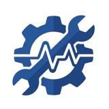

Software engineer in Cilacap, Indonesia, currently a Mobile Application Developer at **Entwo Electronic & Engineering**. I build Android and iOS apps with Ionic and Capacitor, the web and APIs behind them, and native plugins that talk to RFID readers.

### Recent work

<table>
  <tr>
    <td align="center" width="16%"><a href="https://play.google.com/store/apps/details?id=id.co.ssprimadaya.mykura"> <b>MyKura</b></a></td>
    <td align="center" width="16%"><a href="https://play.google.com/store/apps/details?id=id.co.ssprimadaya.berbagik3"> <b>Berbagi K3</b></a></td>
    <td align="center" width="16%"><a href="https://play.google.com/store/apps/details?id=id.co.ssprimadaya.cctvlogsheet"> <b>Monitrax CMMS</b></a></td>
    <td align="center" width="16%"><a href="https://play.google.com/store/apps/details?id=com.ssp.pelakuk3"> <b>PELAKUK3</b></a></td>
    <td align="center" width="16%"><a href="https://trackflow.chimney.id/"> <b>TrackFlow</b></a></td>
    <td align="center" width="16%"><a href="https://powerplantparts.chimney.id/"> <b>Powerplant Parts</b></a></td>
  </tr>
</table>

Open source: [capacitor-plugin-uhf-rfid](https://github.com/itshazlan/capacitor-plugin-uhf-rfid), [cordova-plugin-cs108plugin](https://github.com/itshazlan/cordova-plugin-cs108plugin), [tabsify](https://github.com/itshazlan/tabsify)

### Tools I use

### GitHub stats

  
  

<picture>
  <source media="(prefers-color-scheme: dark)" srcset="https://raw.githubusercontent.com/itshazlan/itshazlan/output/snake-dark.svg" />
  
</picture>

### Get in touch

